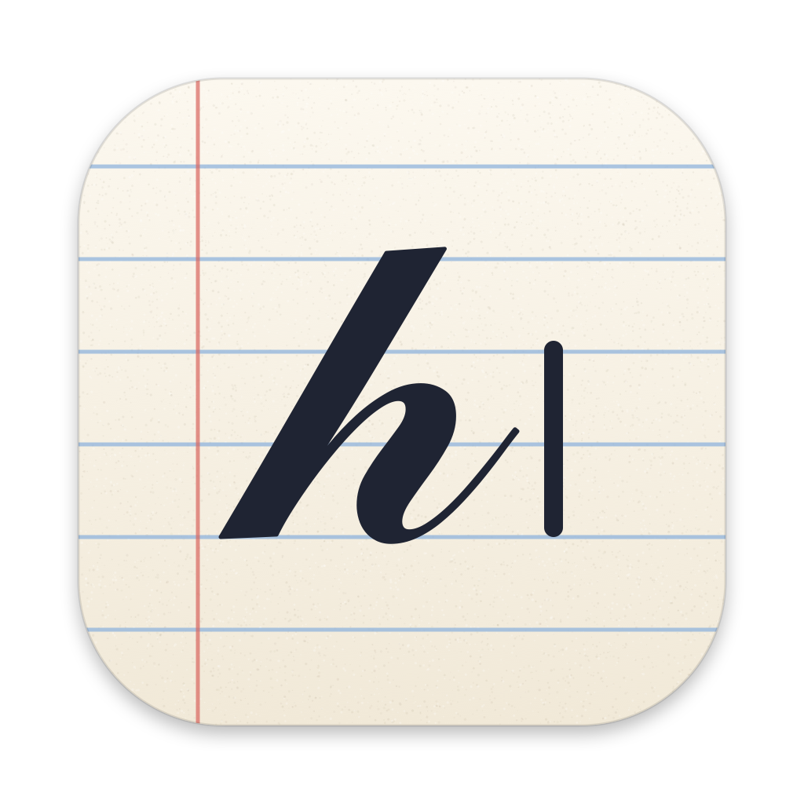

<p align="center"></p>

# Handwritten

A macOS menu bar app that **types out your clipboard like a real person** instead of pasting it, with realistic speed, rhythm, pauses, typos and corrections. Almost every part of it can be adjusted.

## Features

- **Types every character**: letters, symbols, emoji, accents, other languages. Rich text is typed as plain text.
- **Human timing**: WPM or **Timer mode** ("take about 50 minutes"), speed bursts on common words, slower hard-to-reach keys, warm-up, fatigue, thinking pauses, breaks.
- **Realistic typos**: neighbor keys, swapped/doubled/skipped letters, Shift mistakes, common misspellings, wrong words. Each has its own probability.
- **Human corrections**: fix right away, a few letters later, at the end of the word, or much later using the arrow keys. Some typos can be left in, then fixed in a final proofread.
- **End-of-run check**: reads the text box (or select-all + copy), compares it with what should be there, and fixes any differences.
- **Pause / resume exactly** where it stopped. Auto-pause when you click, press a key, or switch apps. **Escape always stops.**
- **Clipboard history** with pins and editing. Picking an item makes it the clipboard; Start types it.
- **Simple / Advanced / Custom** settings modes (200+ settings) with search, a **Humanness** master slider, built-in and custom **presets**, and import/export.
- **Global hotkeys** (recordable), **Mask mode** (hide everything, optional dummy icon), accent colors, light/dark, launch at login.

## Default hotkeys

| Action | Keys |
|---|---|
| Start | ⌃⌥⌘S |
| Pause / Resume | ⌃⌥⌘P |
| Stop | ⌃⌥⌘X or Escape |
| Mask (hide/show) | ⌃⌥⌘H |
| Control panel | ⌃⌥⌘O |

## Install (download)

Works on any Mac running macOS 14 or newer (Apple Silicon or Intel). No Apple developer account needed.

1. Download **Handwritten-x.y.z.dmg** from [Releases](../../releases) and open it.
2. Drag **Handwritten** into **Applications**.
3. Open Handwritten from Applications. macOS says it can't verify the app, because it isn't from the App Store or a paid Apple developer. Click **Done**.
4. Go to **System Settings → Privacy & Security**, scroll down, and click **Open Anyway** next to Handwritten. Confirm with your password.
   - Or skip steps 3–4 by running this once in Terminal:
     ```bash
     xattr -dr com.apple.quarantine /Applications/Handwritten.app
     ```
5. When Handwritten opens, turn on **Accessibility** and **Input Monitoring** for it, then click **Relaunch Handwritten**.

> After updating to a new version, macOS may treat it as a different app. If a permission shows as missing even though it's on, remove Handwritten from that list with **–**, add it again with **+**, and relaunch.

## Build from source

Requires Xcode 16+ and [XcodeGen](https://github.com/yonaskolb/XcodeGen) (`brew install xcodegen`).

```bash
xcodegen generate
open Handwritten.xcodeproj
```

In Xcode, select the **Handwritten** target → **Signing & Capabilities** → choose your (free) Personal Team. Using a team keeps permissions working across rebuilds. Then press **Run**.

To make a release: `./scripts/release.sh` → `dist/Handwritten-<version>.dmg` and `.zip` (builds in `build-release/`, so your dev build in `build/` is untouched). Pushing a tag like `v0.1.0` runs the GitHub Action, which builds the zip and attaches it to a release.

## Notes

- Password fields and some secure apps block simulated typing on purpose (a macOS rule).
- Autocorrect in Word, Docs, etc. can change typos on its own. Turn on **Safe typo mode** or turn off autocorrect.
- For code editors, turn on **Code editor mode**. For perfect results, also turn off auto-closing brackets in your editor.
- Your settings, presets, history and word lists live in `~/Library/Application Support/Handwritten/`.

Use responsibly.
